# AI Writer 界面重构物料

本目录是在 `ui-dev` 分支上产出的界面重构设计物料，用于方向评审，不参与生产构建。当前代码基线：`main` @ `a17bddf`（v0.1.4）。分五轮，分别解决不同层面的问题：

| 轮次 | 解决的问题 | 产出 | 是否改结构 |
| :--- | :--- | :--- | :--- |
| **第六轮 · 浅色主题 UI（当前设计稿）** | 功能不变，只改视觉与层级；按现有界面结构重绘 | [light/](light/) | 否（结构不变） |
| 第五轮 · 主 Agent 单一入口（参考） | 用户只和主助手对话；主助手直接改或委托子助手改；需要时可下钻（涉及功能改动） | [lead/](lead/) | 是（交互模型） |
| 第四轮 · 人机共创（参考） | 人与写作助手如何共同产出内容：接力、对照修订、同屏共写 | [coop/](coop/) | 是（交互模型） |
| 第三轮 · 多助手编排（参考） | agent 与 agent 的分工：委派、排队、审批、团队室（非本次目标） | [collab/](collab/) | 是（交互模型） |
| 第二轮 · 骨架 | 信息架构与布局：面板位置、首页形态、AI 介入方式、核心动作 | [concepts/](concepts/) | 是 |
| 第一轮 · 皮肤 | 视觉语言：配色、字体、圆角、投影、密度 | [mockups/](mockups/) | 否（同一骨架） |

规范文档：[DESIGN-SPEC.md](DESIGN-SPEC.md)。

---

## 第六轮 · 浅色主题 UI 设计图（当前设计稿）

范围：**功能不变，只改 UI**。第一版设计图有凭印象补的结构，已按 0.1.4 代码逐项核对修正（修正记录见 [light/README.md](light/README.md)），覆盖主工作台、正文编辑 + 审稿助手、设置弹窗。

### 主工作台：小说配置 + AI 写作助手


### 正文编辑 + AI 审稿助手


### 设置弹窗


---

## 第五轮 · 主 Agent 单一入口概念稿（参考）

用户默认只和主助手对话；主助手可以直接修改内容，也可以调用工具把修改委托给架构助手、章节蓝图助手；子助手的提案统一回到主助手确认；需要精细修改时，用户可以从委托卡下钻到某个子助手直接对话。详细说明见 [lead/README.md](lead/README.md)。

### 状态一 · 主对话直接修改

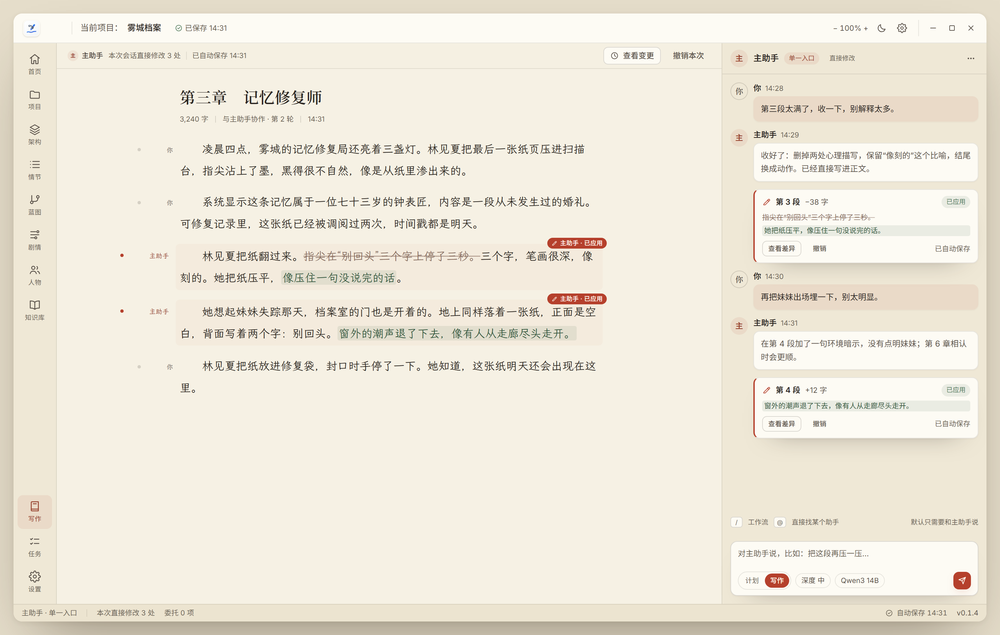

主助手直接改正文，会话里给出变更卡（−38 字 · 已应用 · 查看差异 / 撤销），文档内高亮改动段落并标注"主助手 · 已应用"。

### 状态二 · 委托子助手修改

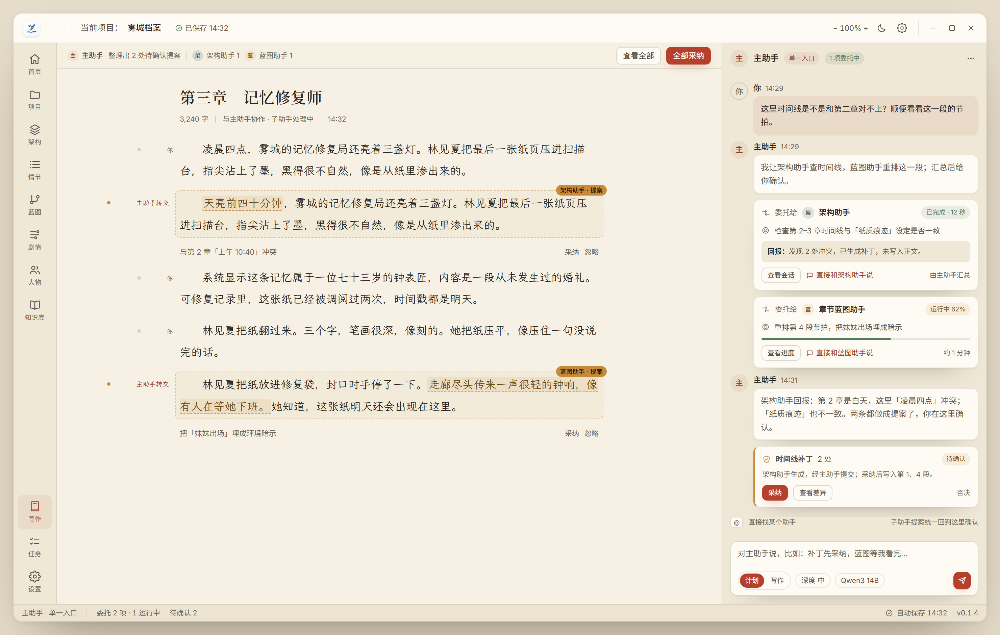

用户只对主助手说一句话，主助手在时间线里生成委托卡（架构助手 · 已完成 / 蓝图助手 · 运行中），子助手提案回到文档并统一在主助手会话里确认。

### 状态三 · 下钻到子助手

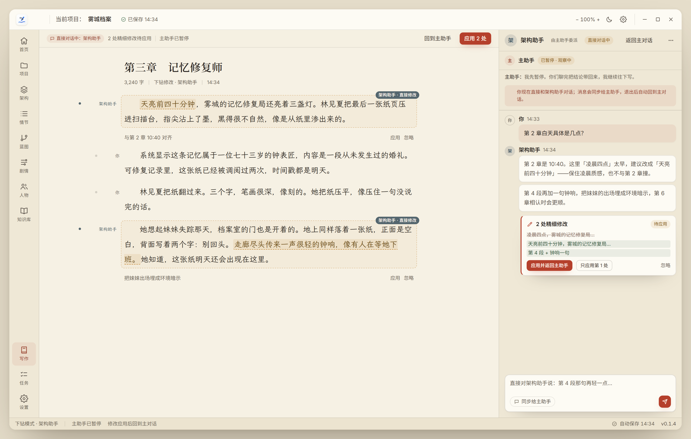

点"直接和架构助手说"后，右侧切换为子助手会话，主助手收起为"已暂停 · 观察中"，子助手在具体段落做精细修改，应用后返回主对话。

---

## 第四轮 · 人机共创概念稿（参考）

这一轮的协作指**人与写作助手一起把内容写出来**。上一轮 `collab/` 是 agent 与 agent 的分工编排，方向不对，保留为参考。详细说明见 [coop/README.md](coop/README.md)。

### 模式一 · 接力写作


回合制推进：页边标出每段作者（你 / 助手 / 你改写自助手稿），助手读到你刚改的段落再续写，底部有完整接力记录。

### 模式二 · 对照修订


双栏对照：你的版本为准、助手稿为草稿；按段采纳、比较、丢弃，锁定段落助手不改；批注锚定到具体段落。

### 模式三 · 同屏共写


同一文档内共写：人一输入助手暂停，助手以光标和浅底文字出现在正文里，可就当前段落提问，人的修改即时同步给助手。

---

## 参考稿 · 多助手编排（agent 与 agent，非本次目标）

这组稿子做的是 agent 与 agent 之间的分工编排：项目助手委派、架构助手与章节蓝图助手执行、忙碌时排队、写入前过确认卡。它回应的是"多助手怎么调度"，不是"人和助手怎么一起写内容"，因此保留为参考，不作为本轮主方案。详细说明见 [collab/README.md](collab/README.md)。

### 模型一 · 指挥台

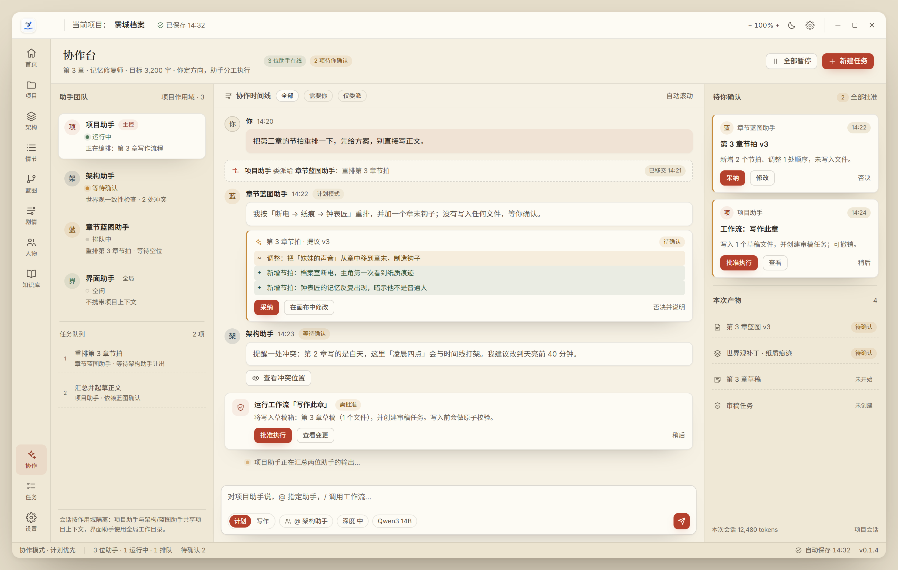

协作时间线 + 助手状态与队列 + 待确认与产物：委派、提案 Diff、工具确认卡、冲突提醒都在同一条时间线上，人是导演。

### 模型二 · 共创画布

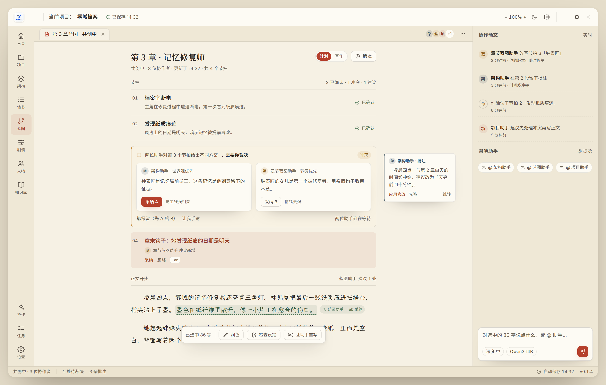

协作进入文档内部：行内建议、页边批注、双助手方案冲突由人裁决、选区操作，右侧只保留协作动态与召唤助手。

### 模型三 · 助手团队室

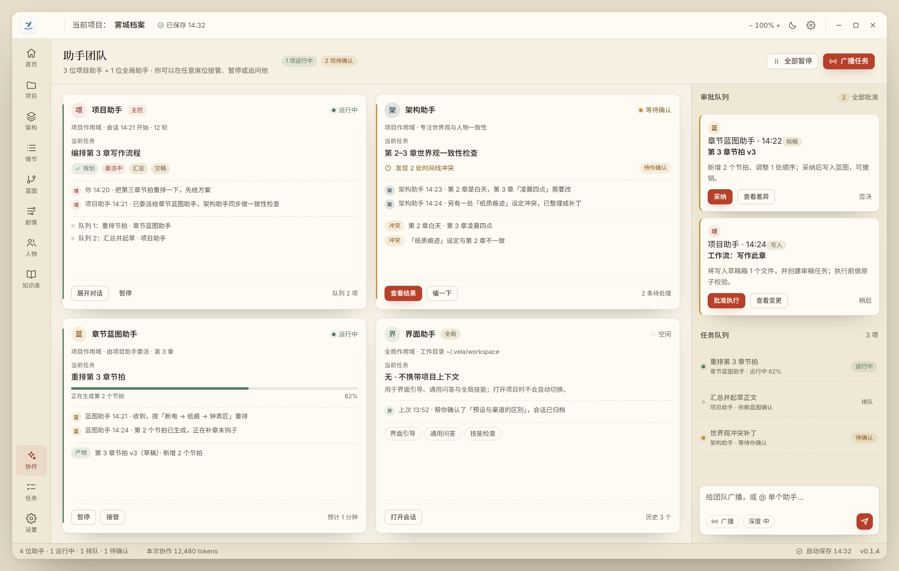

每个助手一个席位：当前任务、进度、最近对话、产物与接管/暂停；右侧是审批队列、任务队列与团队广播。

---

## 第二轮 · 布局概念稿（骨架）

三套概念稿固定同一套配色与字体，差异只来自结构。详细说明见 [concepts/README.md](concepts/README.md)。

### 概念一 · 写作舱


去掉右侧常驻 AI 面板，AI 改为底部指令条 + 页边批注；左栏改为卷/章大纲；正文按页面排版。

### 概念二 · 创作总览台


首页从配置表单变成工作室看板：继续写作、目标环、章节进度、伏笔、角色、节奏、待办；AI 以观察流形式出现。

### 概念三 · 流水线工作台


左栏是七阶段流水线，主区是阶段工作区（章节蓝图表格），右栏是生成面板与 diff 审核、任务队列。

---

## 第一轮 · 视觉语言（皮肤）

同一屏、同一结构，只替换设计语言。

### A. 纸墨书卷 2.0（推荐）

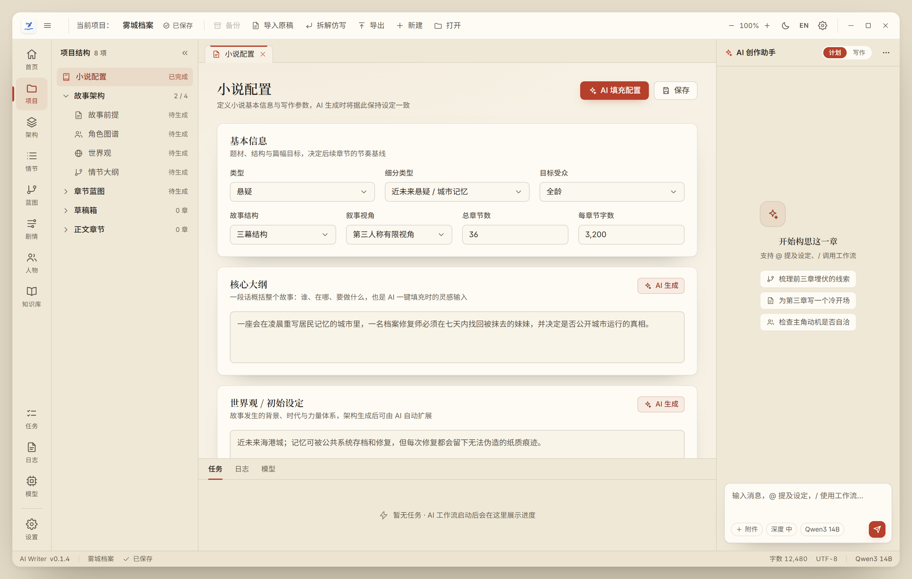

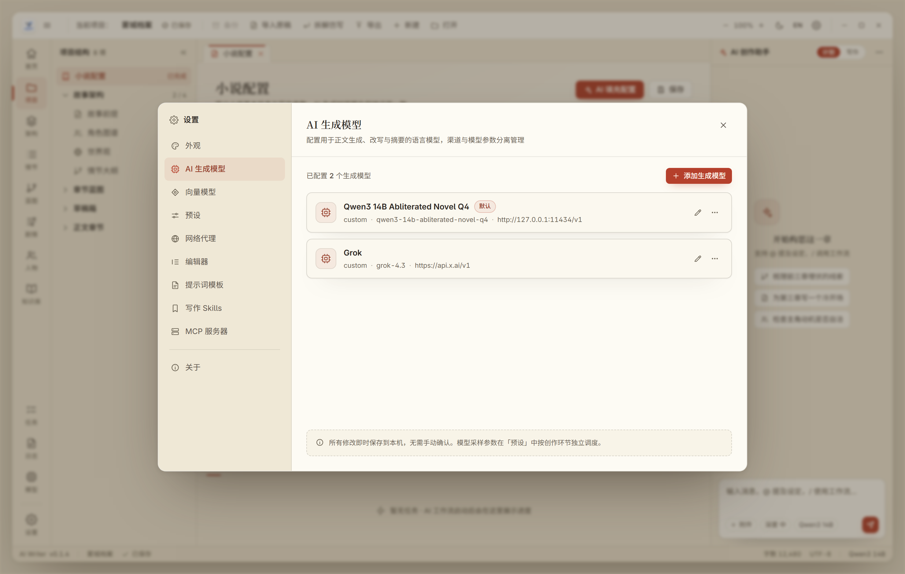

### B. 中性专业 IDE

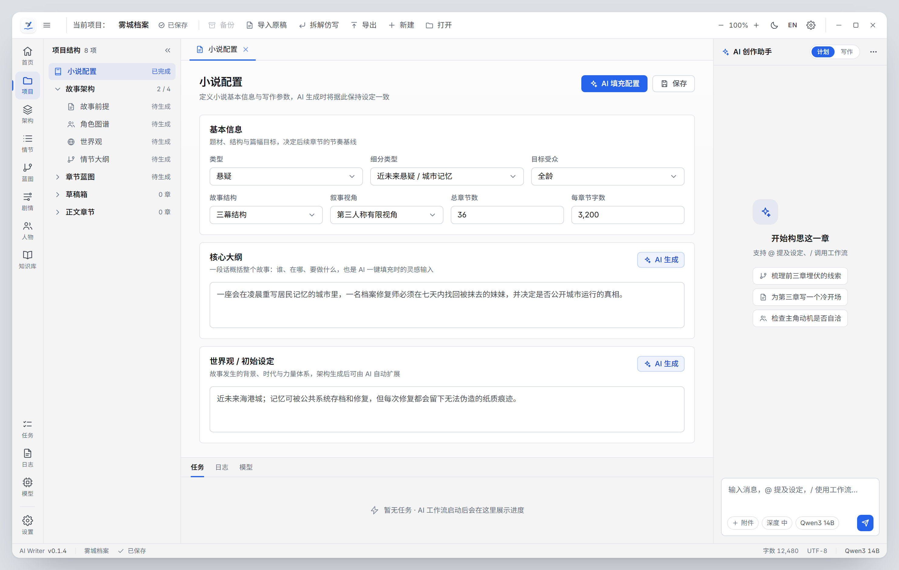

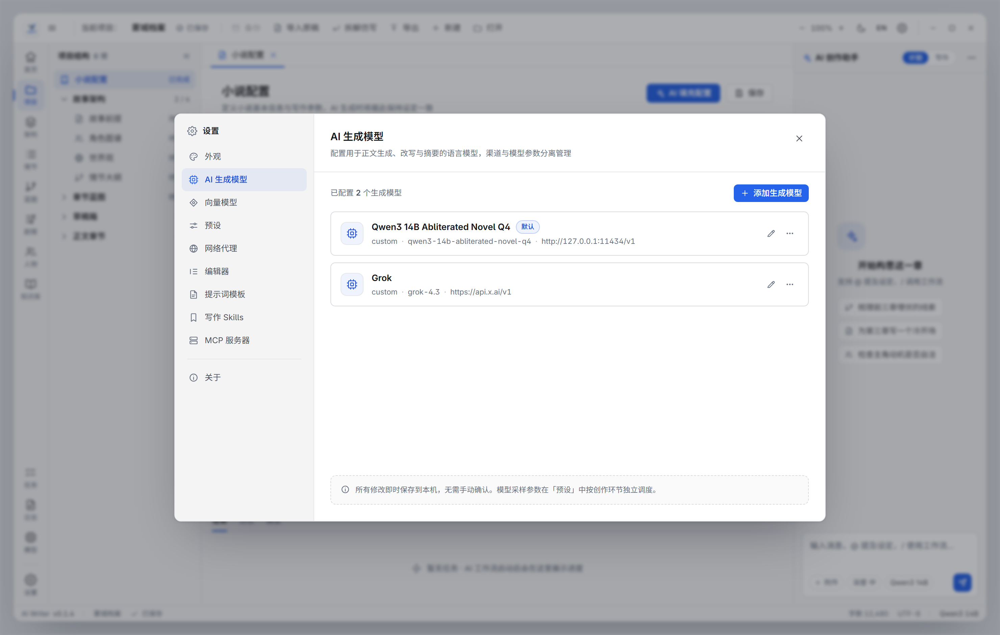

### C. 深色创作舱

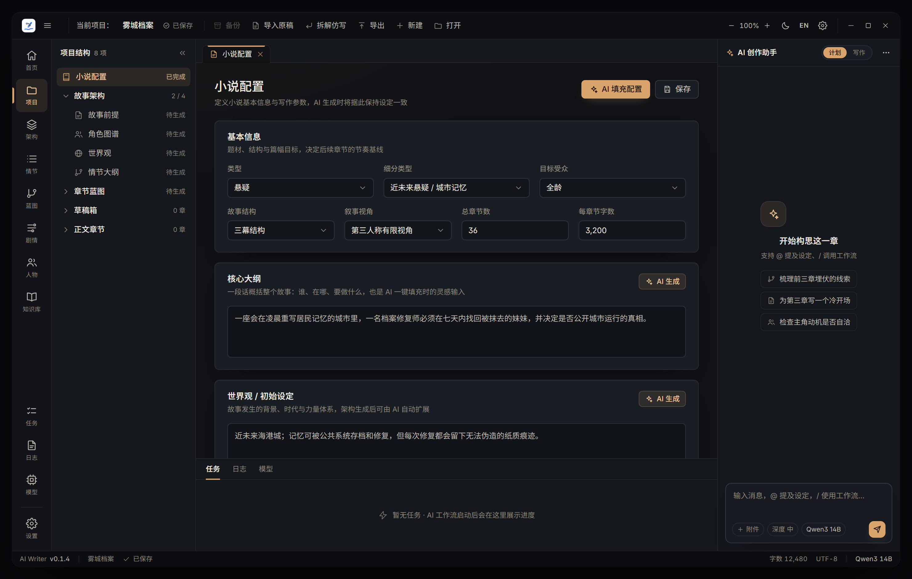

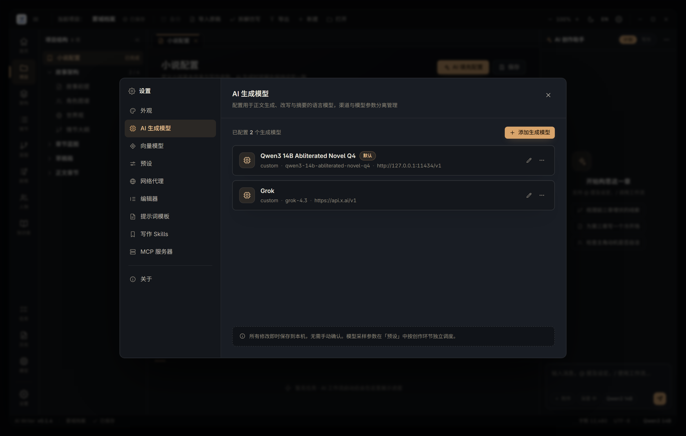

---

## 文件结构

| 路径 | 说明 |
| :--- | :--- |
| `DESIGN-SPEC.md` | 设计规范：令牌架构、字阶、间距、组件规范、色板与对比度、落地路径 |
| `mockups/mockup.html` | 皮肤稿·工作台，`?dir=paper\|neutral\|dark` 切换方向 |
| `mockups/settings.html` | 皮肤稿·设置弹窗，同一 query 参数 |
| `mockups/mockup.css` | 三套皮肤的设计令牌与组件样式 |
| `concepts/focus-writing.html` | 骨架稿·概念一 写作舱 |
| `concepts/studio-dashboard.html` | 骨架稿·概念二 创作总览台 |
| `concepts/pipeline-workbench.html` | 骨架稿·概念三 流水线工作台 |
| `concepts/base.css` | 概念稿共享基座（固定一套配色与字体） |
| `concepts/icons.js` | 概念稿图标精灵 |
| `collab/director-console.html` | 协作稿·指挥台 |
| `collab/co-creation-canvas.html` | 协作稿·共创画布 |
| `collab/agent-team-room.html` | 协作稿·助手团队室 |
| `collab/collab.css` | 协作稿共享组件（复用概念稿基座） |
| `coop/turn-taking.html` | 共创稿·接力写作 |
| `coop/draft-merge.html` | 共创稿·对照修订 |
| `coop/live-co-writing.html` | 共创稿·同屏共写 |
| `coop/coop.css` | 共创稿共享组件（复用协作稿组件） |
| `lead/state-main-chat.html` | 主 Agent 稿·直接修改 |
| `lead/state-delegation.html` | 主 Agent 稿·委托子助手 |
| `lead/state-drilldown.html` | 主 Agent 稿·下钻子助手 |
| `lead/lead.css` | 主 Agent 稿共享组件 |
| `lead/CODE-REVIEW.md` | 主 Agent 架构的代码现状与差距分析 |
| `light/main-config.html` | 浅色稿·主工作台 |
| `light/editor-review.html` | 浅色稿·正文与审稿 |
| `light/settings.html` | 浅色稿·设置弹窗 |
| `light/light.css` | 浅色主题令牌与组件样式 |
| `*.png` | 渲染产物，2960 × 1880（2 倍图） |

字体直接引用仓库内 `public/fonts/` 的 Inter、思源黑体、思源宋体、霞鹜文楷，与产品实际字体一致。

## 重新生成

需要本机有 Chrome（Windows 路径示例）：

```bash
CHROME="/mnt/c/Program Files/Google/Chrome/Application/chrome.exe"
BASE="D:\\Document\\ai-writer\\.agents\\worktrees\\ui-dev\\docs\\ui-redesign"
URL="file:///D:/Document/ai-writer/.agents/worktrees/ui-dev/docs/ui-redesign"

# 皮肤稿
for pair in "a-paper-v2 paper" "b-neutral-pro neutral" "c-dark-studio dark"; do
  set -- $pair
  "$CHROME" --headless=new --disable-gpu --hide-scrollbars \
    --allow-file-access-from-files --force-device-scale-factor=2 \
    --window-size=1480,940 --virtual-time-budget=4000 \
    --screenshot="$BASE\\mockups\\$1.png" "$URL/mockups/mockup.html?dir=$2"
  "$CHROME" --headless=new --disable-gpu --hide-scrollbars \
    --allow-file-access-from-files --force-device-scale-factor=2 \
    --window-size=1480,940 --virtual-time-budget=4000 \
    --screenshot="$BASE\\mockups\\$1-settings.png" "$URL/mockups/settings.html?dir=$2"
done

# 骨架稿
for pair in "focus-writing concept-1-focus" "studio-dashboard concept-2-dashboard" "pipeline-workbench concept-3-pipeline"; do
  set -- $pair
  "$CHROME" --headless=new --disable-gpu --hide-scrollbars \
    --allow-file-access-from-files --force-device-scale-factor=2 \
    --window-size=1480,940 --virtual-time-budget=4000 \
    --screenshot="$BASE\\concepts\\$2.png" "$URL/concepts/$1.html"
done
```

也可以直接用浏览器打开对应 HTML 交互查看。

## 边界

- 设计稿内的项目名、模型名、字数均为示意数据；
- 所有界面文案遵循项目规范：无 Emoji、无解释性括号后缀；
- 选中骨架与皮肤后再进入令牌落地与组件改造，执行顺序见 [DESIGN-SPEC.md](DESIGN-SPEC.md) 第 8 节。
