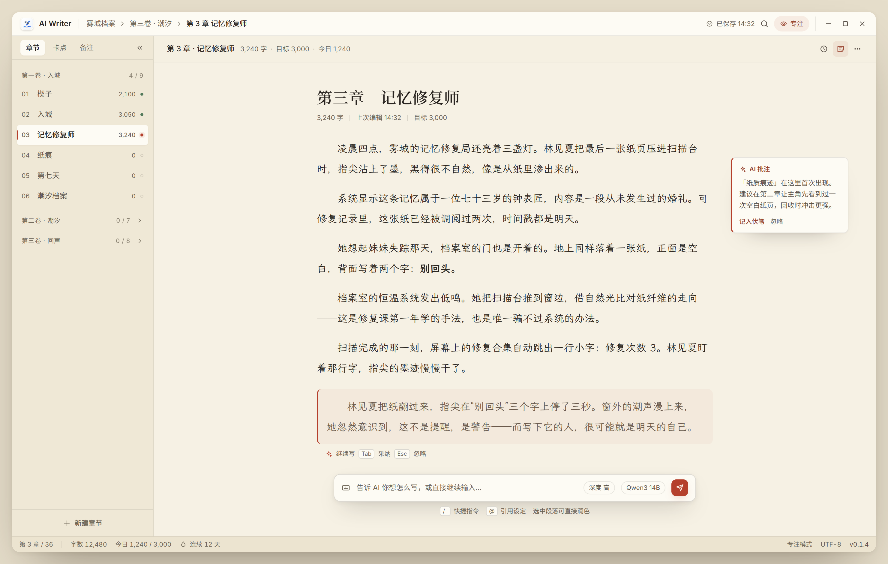
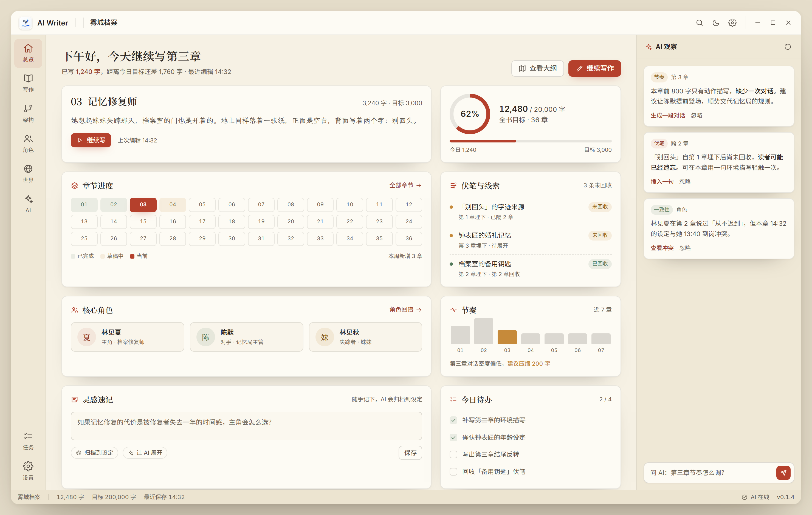
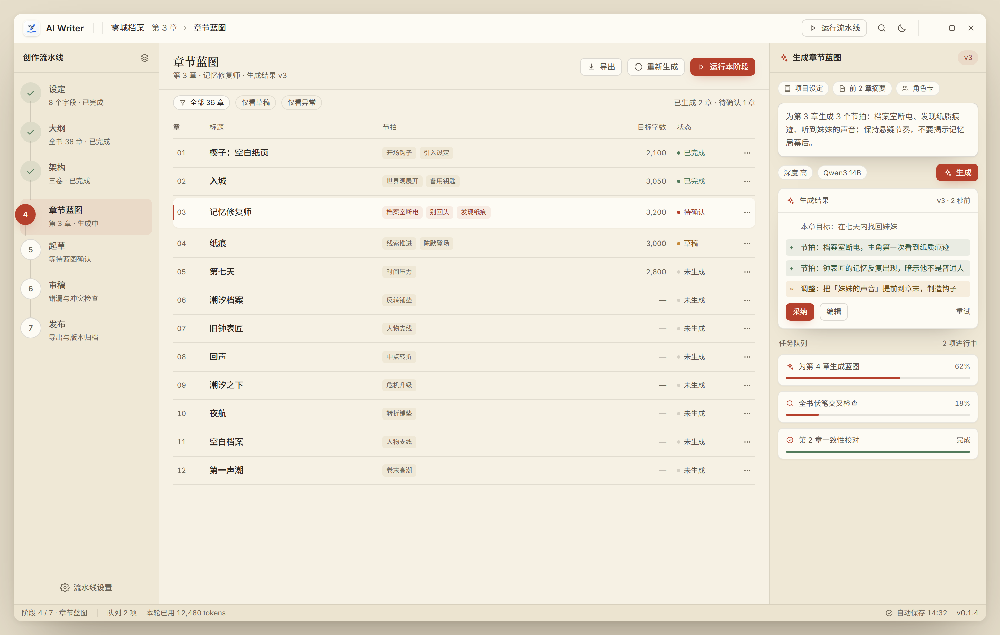

# 布局概念稿（骨架层）

上一轮的 `../mockups/` 解决的是**视觉语言**：配色、字体、圆角、投影、密度——同一套骨架换三种外观。本目录解决的是**信息架构与布局**：面板放哪、首页是什么、AI 以什么方式介入、核心动作是什么。

三套概念稿刻意固定同一套配色与字体（纸墨书卷 2.0），只为让差异只来自结构本身。

---

## 概念一 · 写作舱（Focus Writing）



**结构变化**

- 删除右侧常驻 AI 面板——这是当前界面最挤的一块。AI 改为**底部指令条 + 页边批注**两种形态，只在需要时出现；
- 左栏从"项目结构树"改为**章节大纲**：按卷分组、显示每章字数与完成状态，写作时视线不用离开正文；
- 顶栏压缩到 40px，只保留面包屑、保存态、专注开关；
- 正文按"页面"呈现：660px 版心、霞鹜文楷、首行缩进、页边留白。

**交互模型**：默认直接进入写作；`/` 指令、`@` 引用、选中润色、Tab 采纳 AI 续写。

**适合**：以码字为主的作者，每天打开就想写。
**代价**：项目配置、设定管理被收进二级入口。

---

## 概念二 · 创作总览台（Studio Dashboard）



**结构变化**

- 首页不再是"小说配置表单"，而是**工作室看板**：继续写作、目标环、36 章进度网格、伏笔、角色、节奏、灵感速记、待办；
- 右侧常驻**AI 观察流**：不是聊天框，而是按"节奏 / 伏笔 / 一致性"分类的主动建议，每条可直接生成或忽略；
- 左栏按**功能模块**组织：总览、写作、架构、角色、世界、AI。

**交互模型**：打开项目先看"今天该做什么"，再点卡片进入写作；AI 以建议流的方式主动介入。

**适合**：多线管理型作者，或需要长期跟进的百万字项目。
**代价**：多一层入口，写作者可能觉得"每次要点两下才能写字"。

---

## 概念三 · 流水线工作台（Pipeline Workbench）



**结构变化**

- 左栏变成**七阶段创作流水线**（设定 → 大纲 → 架构 → 章节蓝图 → 起草 → 审稿 → 发布），当前阶段高亮，已完成阶段打勾；
- 主区是**阶段工作区**：章节蓝图用表格承载（章/标题/节拍/目标字数/状态），可批量生成、筛选、确认；
- 右栏是**生成面板**：上下文芯片、提示词、模型与深度、生成结果 diff（采纳 / 编辑 / 重试）、任务队列；
- 底部状态栏展示阶段进度与 token 消耗。

**交互模型**：以"阶段推进"为主轴，作者审核 AI 产出、确认后进入下一阶段。

**适合**：重度使用 AI 流水线的用户，以及需要批量生成、统一审核的创作流程。
**代价**：写作本身的沉浸感弱，纯写作者会觉得机器味重。

---

## 三套骨架的差异一览

| | 概念一 写作舱 | 概念二 总览台 | 概念三 流水线 |
| :--- | :--- | :--- | :--- |
| 默认首页 | 正文编辑器 | 工作室看板 | 当前流水线阶段 |
| 左栏 | 卷 / 章大纲 | 功能模块 | 七阶段流水线 |
| AI 位置 | 底部指令条 + 页边批注 | 右侧观察流 | 右侧生成面板 + diff |
| 核心动作 | 继续写 | 继续写作 / 看进度 | 运行本阶段 / 采纳结果 |
| 信息密度 | 低（专注） | 中高（总览） | 高（表格 + 结果） |
| 修改量 | 中（拆掉右栏） | 大（新增看板首页） | 大（导航改为流程） |
| 风险 | 项目管理者找不到入口 | 写作启动路径变长 | 写作体验被流程化 |

## 与皮肤层的关系

骨架与皮肤是正交的：`3 套骨架 × 3 套皮肤 = 9 种组合`。建议先定骨架，再在骨架内选皮肤，最后细化交互态与组件规范。

## 渲染

```bash
CHROME="/mnt/c/Program Files/Google/Chrome/Application/chrome.exe"
BASE="D:\\Document\\ai-writer\\.agents\\worktrees\\ui-dev\\docs\\ui-redesign\\concepts"
URL="file:///D:/Document/ai-writer/.agents/worktrees/ui-dev/docs/ui-redesign/concepts"

"$CHROME" --headless=new --disable-gpu --hide-scrollbars --allow-file-access-from-files \
  --force-device-scale-factor=2 --virtual-time-budget=4000 --window-size=1480,940 \
  --screenshot="$BASE\\concept-1-focus.png" "$URL/focus-writing.html"
```

`studio-dashboard.html`、`pipeline-workbench.html` 同理。
