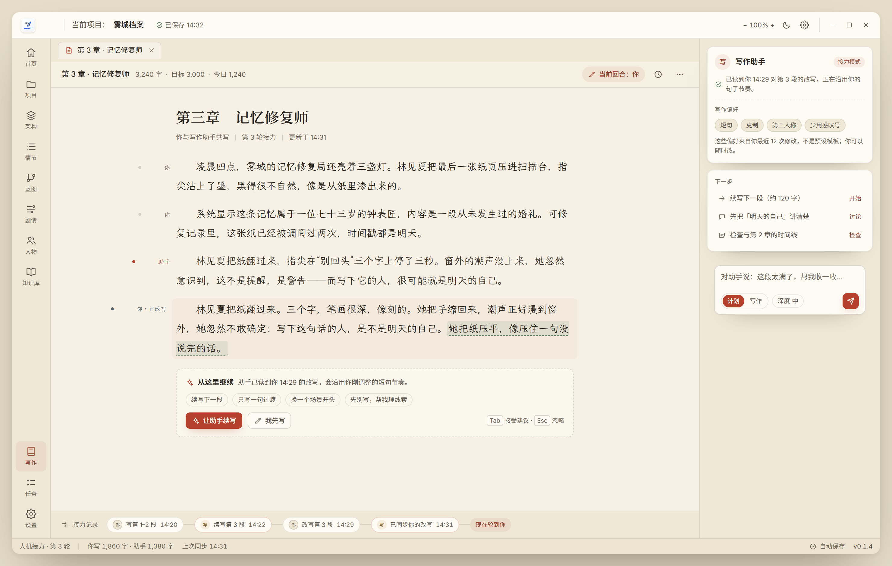
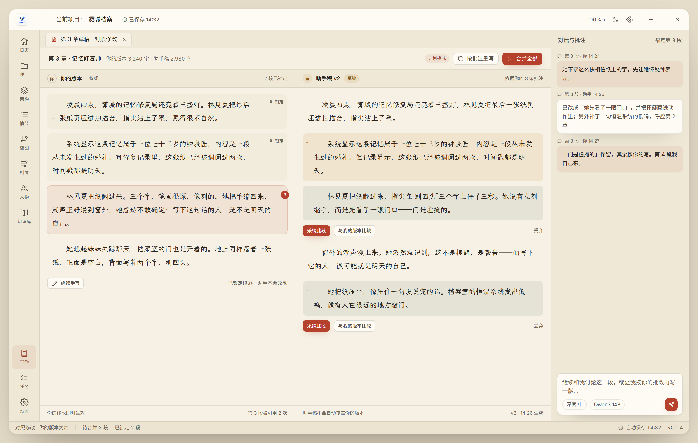
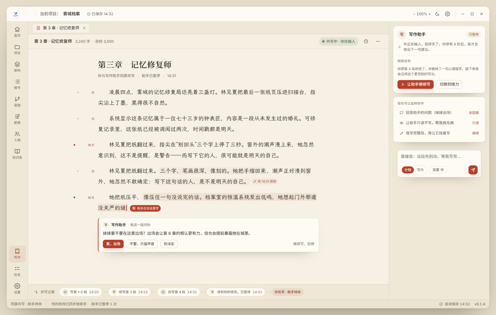

# 人机共创概念稿（本轮重点）

这一轮的协作指**人与一个写作助手共同把内容写出来**，而不是 agent 与 agent 之间分工写作。上一轮 `../collab/` 做的是委派、排队、团队室，属于 agent 编排，不是本次要的协作形态，保留为参考。

三套稿固定同一套皮肤（纸墨书卷 2.0），差异只来自人机协作方式。

---

## 模式一 · 接力写作（Turn-taking）



- **回合制**：顶栏显示"当前回合：你"；底部是接力记录（你写 → 助手续写 → 你改写 → 助手已同步）；
- **作者归属**：页边标记标出每段是你写的、助手写的、还是"你 · 已改写自助手稿"；
- **以人的稿子为准**：助手在你改写过的地方重新同步，沿用你的短句节奏，而不是继续它原来的版本；
- **接力卡**：在文末直接决定"让助手续写 / 我先写"，以及续写范围与方式；
- 右侧是写作助手：读到哪一段、从你最近 12 次修改中学到的偏好、下一步建议。

**适合**：逐段推进、喜欢自己掌控节奏的作者。

## 模式二 · 对照修订（Draft & Merge）



- **双栏**：左"你的版本"（权威），右"助手稿 v2"（草稿），互不覆盖；
- **段落级合并**：采纳此段 / 与我的版本比较 / 丢弃，按段决定，不整章替换；
- **锁定段落**：你锁定的段落，助手不会改动；
- **批注锚定**：对话直接挂在第 3 段上，"先让她怀疑钟表匠"这类修改意见可追溯；
- **按批注重写**：助手依据你的批注生成下一版，而不是自由发挥。

**适合**：改稿、审读、需要保留两个版本的阶段。

## 模式三 · 同屏共写（Live Co-writing）



- **同一文档内共写**：助手以光标、浅底文字和"助手正在这里写"标签出现在正文里，而不是躲在侧栏；
- **人一输入就暂停**：你开始打字，助手立即停手；你停笔 8 秒后才给下一句建议，避免抢写；
- **就地提问**：助手可以针对当前段落提问（"妹妹要不要在这里出场？"），给出选项而不是打断对话；
- **修改即时同步**：你刚改的句子标为"你 14:31 修改"，助手已读到并按你更克制的写法继续；
- 右侧是伙伴状态、可切换的协作方式、以及"让助手继续写 / 切换到接力"。

**适合**：日常写作主场景，写与改连续发生时。

---

## 共同机制（与现有产品对应）

| 界面机制 | 对应现有能力 |
| :--- | :--- |
| 计划 / 写作模式 | 计划模式先出 Diff 审阅，写作模式才自动落笔 |
| 选中即操作 | 选区润色、改写、检查设定 |
| 作者归属与接力记录 | 谁写的、谁改的、何时改写可回溯 |
| 偏好来自人的修改 | 文风分析 / 仿写指南，而不是静态提示词 |
| 助手暂停 / 接管 | 人随时可以让助手停手或接手 |
| 合并与锁定 | 段落级采纳、锁定段落不被覆盖 |
| 写入安全 | 内容变更仍走原子写入与确认语义 |

## 与 agent 编排的区别

| | 本轮（人机共创） | 上一轮（collab/） |
| :--- | :--- | :--- |
| 协作对象 | 人 ↔ 写作助手 | agent ↔ agent |
| 核心问题 | 内容怎么一起写出来 | 任务怎么分派、排队、审批 |
| 成功标准 | 作者写得顺、改得动、归属清楚 | 任务流转不丢、状态可见 |
| 产品位置 | 写作主界面 | 任务/流程视图 |

## 建议

- 主线用**同屏共写**做日常写作；
- 改稿期切**对照修订**；
- **接力写作**作为逐段推进的轻模式；
- 三者共享同一套"回合 / 归属 / 暂停 / 合并"语义，在一个写作视图里切换，而不是三个割裂功能。

## 渲染

```bash
CHROME="/mnt/c/Program Files/Google/Chrome/Application/chrome.exe"
BASE="D:\\Document\\ai-writer\\.agents\\worktrees\\ui-dev\\docs\\ui-redesign\\coop"
URL="file:///D:/Document/ai-writer/.agents/worktrees/ui-dev/docs/ui-redesign/coop"

"$CHROME" --headless=new --disable-gpu --hide-scrollbars --allow-file-access-from-files \
  --force-device-scale-factor=2 --virtual-time-budget=4000 --window-size=1480,940 \
  --screenshot="$BASE\\coop-1-relay.png" "$URL/turn-taking.html"
```

另外两个页面同理。
