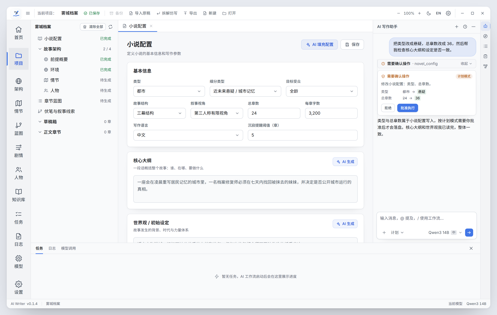
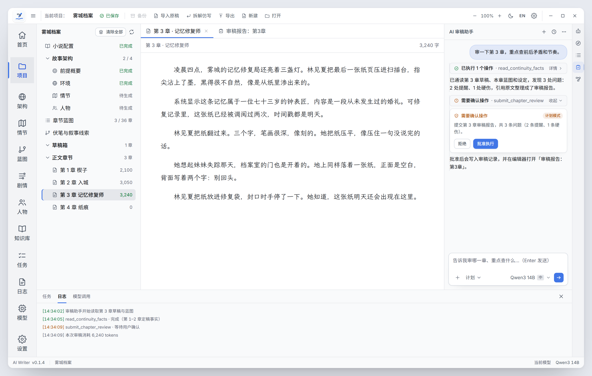
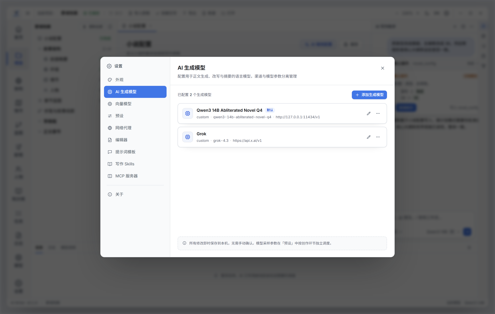

# 浅色主题 UI 设计图（功能不变）

本轮只做 UI：视觉、层级、组件外观。功能、交互流程、数据、IPC、工具与委派行为全部保持现状。设计图按当前代码结构绘制——和 0.1.4 的实际界面一一对应，不是另起一套产品。

## 三张图

### 1. 主工作台：小说配置 + AI 写作助手



- 标题栏保留当前全部动作：备份（禁用）、导入原稿、拆解仿写、导出、新建、打开，右侧缩放、主题、语言、设置、窗口按钮；
- 左侧导航与项目树按当前实现：首页 / 项目 / 架构 / 情节 / 蓝图 / 剧情 / 人物 / 知识库 + 任务 / 日志 / 模型 / 设置；
- 页面仍是「小说配置」，字段与分组不变；
- 右侧是 AI 写作助手面板：消息、工具调用卡、计划模式下的确认卡（`novel_config` 字段 diff）、底部输入区（添加 / 计划 / 模型 / 发送）；
- 底部面板是「任务」，展示批量创作进度；
- 最右侧是工具窗栏：AI 助手 / 架构 / 蓝图 / 审稿 / AI 输出。

### 2. 正文编辑 + AI 审稿助手



- 编辑区展示第 3 章正文（写作字体、版心、行高）；
- 标签页含正文与「审稿报告：第 3 章」，对应 `open_review_report` 打开的真实标签；
- 右侧切到 AI 审稿助手：对话、`read_continuity_facts` 工具卡、`submit_chapter_review` 的确认卡（列出 3 条问题）、输入区；
- 底部面板是日志视图，展示审稿过程的日志行。

### 3. 设置弹窗



- 设置弹窗结构不变：左侧 10 个设置分区、右侧内容、底部即时保存提示；
- 目前展示「AI 生成模型」，包含模型列表、默认标记、添加按钮。

## 对照代码修正记录

第一版设计图有几处是凭印象补的，和 0.1.4 实际实现不一致；已按代码逐项改正：

| 项目 | 第一版（错） | 已改为（对照代码） |
| :--- | :--- | :--- |
| 左侧导航 | 51px 项高、19px 图标、10px 标签 | 65–66px 项高、22px 图标、13px 标签 |
| 项目树 | 故事前提 / 角色图谱 / 世界观 / 情节大纲 | 小说配置；故事架构（前提概要 / 环境 / 情节 / 人物）；章节蓝图；伏笔与叙事线索；草稿箱；正文章节 |
| 助手消息 | 头像 + 气泡（助手也是气泡） | 用户消息右对齐气泡；助手消息为整行 Markdown 文本，无头像无气泡 |
| 工具调用 | 单独的工具卡 | 折叠汇总条（"已执行 N 个操作 / 需要确认操作" + 工具名），展开后是工具卡或确认卡 |
| 确认卡按钮 | 批准 / 拒绝 | 拒绝 / 批准执行 |
| 编辑区 | 自造的大标题 + meta 行 | 扁平标签页（底部 2px 指示线）+ 36px 信息栏（文件名 / 字数 / dirty / 保存） |
| 设置弹窗 | 964×604、浅底选中 | 880×600、左导航 208px、当前项实心强调色 |
| 配置页字段 | 只画 3 个分区 | 补 写作语言、沉寂提醒阈值，并补 金手指 / 主角人设 等后续分区；字段名改为 总章数 / 每章字数 |
| 右侧工具窗栏 | 不对应的图标 | Bot / DraftingCompass / ListTree / ClipboardCheck / Workflow |

仍然**不是像素级还原**的部分：

- 三栏宽度可拖拽（侧栏约 20%、AI 面板默认 320px、底部面板约 25%），图里按默认值近似；
- CodeMirror 的行号、光标、选区等运行时元素没有画；
- 审稿确认卡里的 3 条问题摘要为示意（真实 `ConfirmCard` 对 `submit_chapter_review` 只渲染通用描述 + 参数预览）；
- 日志行与任务进度是示例数据。

## 视觉规范

| 类别 | 取值 |
| :--- | :--- |
| 应用底 / 面板 / 卡片 | `#F7F8FA` / `#F9FAFB` / `#FFFFFF` |
| 边框 | `#E5E7EB`（弱）/ `#D6DBE2`（控件） |
| 文字 | `#0F1115`（主）/ `#4B5563`（次）/ `#5B6472`（弱） |
| 强调色 | `#4176E6`，文字强调 `#1D4ED8`，浅底 `rgba(65,118,230,.08)` |
| 语义色 | 成功 `#15803D`，警告 `#B45309`，危险 `#DC2626` |
| 字号 | 页面标题 19 / 卡片标题 13.5 / 正文 12.5–13 / 说明 11 / 元信息 10.5 |
| 控件高度 | 26 / 32 / 40（工具栏 / 输入框 / 面板头） |
| 圆角 | 5 / 7 / 9 / 12 |
| 阴影 | 卡片 `0 1px 2px` + 大范围低透明度；弹窗 `0 40px 90px -32px` |
| 图标 | lucide 风格，14 / 15 / 19，描边 1.7–1.75 |

## 与现有组件对应

| 设计图区域 | 代码组件 |
| :--- | :--- |
| 标题栏 | `src/components/layout/TitleBar.tsx` |
| 左侧导航 | `src/components/layout/LeftToolWindowBar.tsx` |
| 右侧工具窗栏 | `src/components/layout/RightToolWindowBar.tsx` |
| 项目树 | `src/components/panels/sidebar/ProjectTree.tsx` |
| 标签页 / 编辑区 | `src/components/panels/EditorArea.tsx` |
| 助手面板 | `src/components/panels/agent/AgentHeader.tsx`、`AgentConversation.tsx`、`AgentMessage.tsx`、`AgentInputBox.tsx` |
| 工具卡 / 确认卡 | `ToolCallBlock.tsx`、`ConfirmCard.tsx` |
| 底部面板 | `src/components/panels/BottomPanel.tsx` |
| 状态栏 | `src/components/layout/StatusBar.tsx` |
| 设置弹窗 | `src/components/settings/SettingsModal.tsx` |

## 明确不改的东西

- IPC、主进程、工具集、委派语义、会话存储、计划/写作模式、确认逻辑；
- 四个助手的入口与职责；
- 页面与弹窗的信息结构；
- 主题切换、语言切换、缩放等现有能力。

## 落地方式（后续）

1. 先改 `src/index.css` 的 light 主题令牌（颜色 / 字号 / 间距 / 圆角 / 阴影）；
2. 再改壳层组件样式（标题栏、导航、面板、状态栏）；
3. 最后改助手面板与设置页的组件外观；
4. 不改任何事件、状态与 Props，只动样式与结构安全的 className；用 `tsc --noEmit` 与现有测试验证。

## 渲染

```bash
CHROME="/mnt/c/Program Files/Google/Chrome/Application/chrome.exe"
BASE="D:\\Document\\ai-writer\\.agents\\worktrees\\ui-dev\\docs\\ui-redesign\\light"
URL="file:///D:/Document/ai-writer/.agents/worktrees/ui-dev/docs/ui-redesign/light"

"$CHROME" --headless=new --disable-gpu --hide-scrollbars --allow-file-access-from-files \
  --force-device-scale-factor=2 --virtual-time-budget=4000 --window-size=1480,940 \
  --screenshot="$BASE\\light-1-main.png" "$URL/main-config.html"
```

其余两张同理（`editor-review.html`、`settings.html`）。
