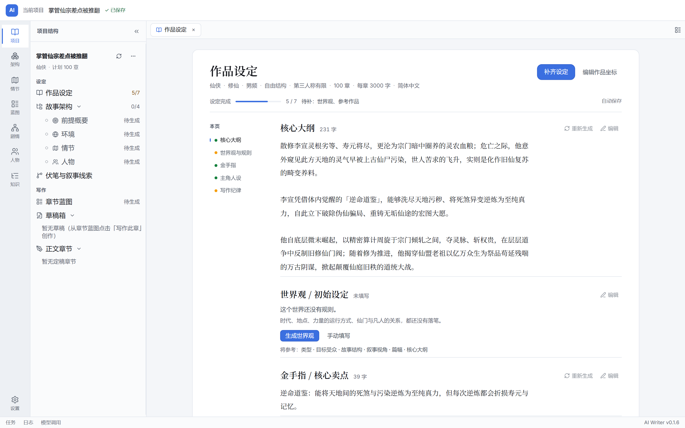
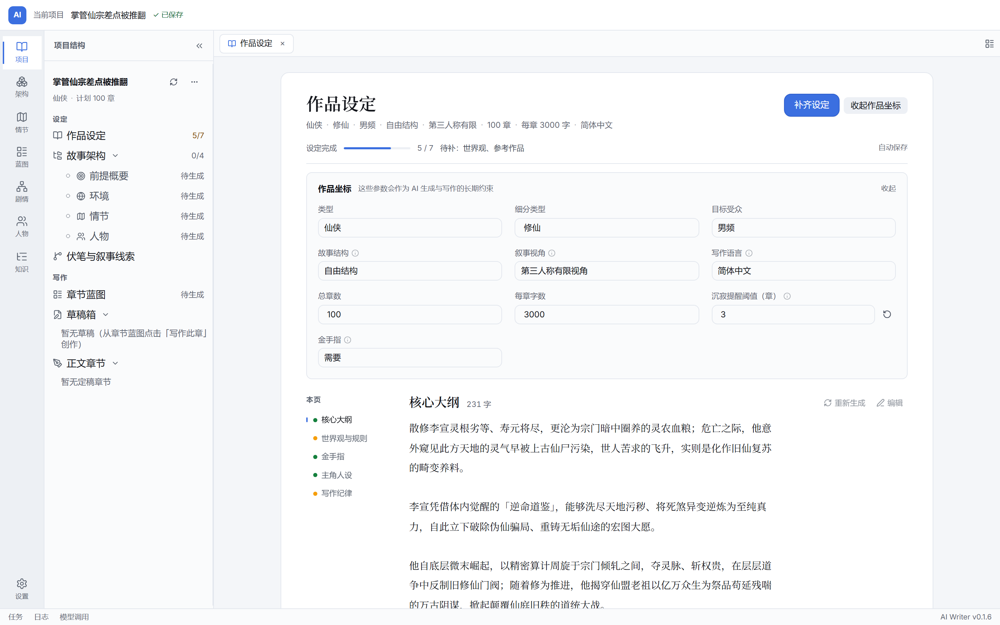

# 作品设定页 — 评审稿与 A 方案落地

针对项目工作区里的「小说配置」页，把它从设置表单改为「作品设定台」。四个构图共用同一套生产主题令牌、本地字体和窗口外壳；评审后采用 **A · 手稿页** 进入生产实现。

## 生产实现（A 方案）

- 页面是一份连续的设定文档：标题、作品坐标摘要、完成度、页边目录，以及核心大纲 / 世界观 / 金手指 / 主角 / 写作纪律。
- 作品坐标默认收成一行摘要，点「编辑作品坐标」展开 3 列参数面板；修改即自动保存，不再有「保存」按钮。
- 正文默认是阅读态，点「编辑」或正文进入原地编辑；点「完成」回到阅读态。
- 空章节给出「生成 / 手动填写」，并列出 AI 会参考的作品坐标与前置设定；「重新生成」会直接覆盖该字段（预览与 diff 留待后续）。
- 页头「补齐设定」会按生成链补第一个空字段；参考作品不参与 AI 生成，需手动填写。
- 页边目录滚动时跟随高亮；窄窗口下目录折成横向导航。
- 项目侧栏按「设定 / 写作」分组；「清除全部」移入项目 ⋯ 菜单，标题栏不再重复项目名。

实现位置：`src/components/editor/NovelConfigEditor.tsx`、`src/components/panels/sidebar/ProjectTree.tsx`、`src/index.css`；配置 Tab 名称同步改为「作品设定 / Story settings」。右侧助手面板保持现有布局，没有在打开设定页时强制收起。

## 评审稿

### A · 手稿页（已采用）

`a-document.html` / `preview-a.png`

- 中央是一张连续的纸：标题、作品坐标一行、四个可读章节（核心大纲 / 世界观 / 主角 / 写作纪律）。
- 左侧页边目录只有四个锚点，不增加第三层导航。
- 生成是章节内的动作：空章节给「生成世界观 / 先写一句」，并提前列出会参考的上下文；已有内容可重新生成。
- 最适合这个产品：作者先读懂自己的书，再决定让 AI 补哪一段。

### D · 混合方案

`d-hybrid.html` / `preview-d.png`

- 以 A 的连续设定文档为主画面；右侧「补全设定」抽屉只在需要生成时打开。
- 抽屉沿用 B 的生成顺序、参考项、当前项；文档左侧目录带上 C 的状态点。
- 没有进入生产：A 的文档构图已经足够，抽屉会压缩正文，且需要额外的浮层/响应式规则。

### B · 工作台

`b-workbench.html` / `preview-b.png`

- 顶部一行作品坐标参数带，下面三栏：本页目录 / 正文编辑 / 右侧补全设定抽屉。
- 生成控制最强，但页面更像工具台，阅读感弱于 A。

### C · 故事脊柱

`c-spine.html` / `preview-c.png`

- 一条纵向的设定脊柱，每个章节一个状态节点；核心大纲展开，其余收起为一行摘要。
- 最容易一眼看出「还差哪几项」，适合开书前补齐设定；阅读感最弱。

## 共同改动

- **项目目录分组**：从平铺改为「设定 / 写作」两组；作品设定、故事架构、伏笔与叙事线索在设定组，章节蓝图、草稿箱、正文章节在写作组。
- **作品坐标**：类型、受众、结构、视角、篇幅、语言、金手指从 3×4 输入网格收成一行摘要，点「编辑作品坐标」再改。
- **AI 生成**：空章节给出参考上下文；生成仍是单字段覆盖，预览与冲突 diff 留待后续。
- **保存**：去掉「保存」按钮，配置修改 700ms 防抖自动保存，切换 Tab 或卸载时立即落盘。
- **破坏性操作**：清除/删除收进项目 ⋯ 菜单并二次确认。

## 预览

直接双击 HTML；字体从仓库 `public/fonts/` 本地加载，无需启动服务。评审稿截图均为 1440×900 @2x；实现截图由真实组件在 Chromium 中渲染。
