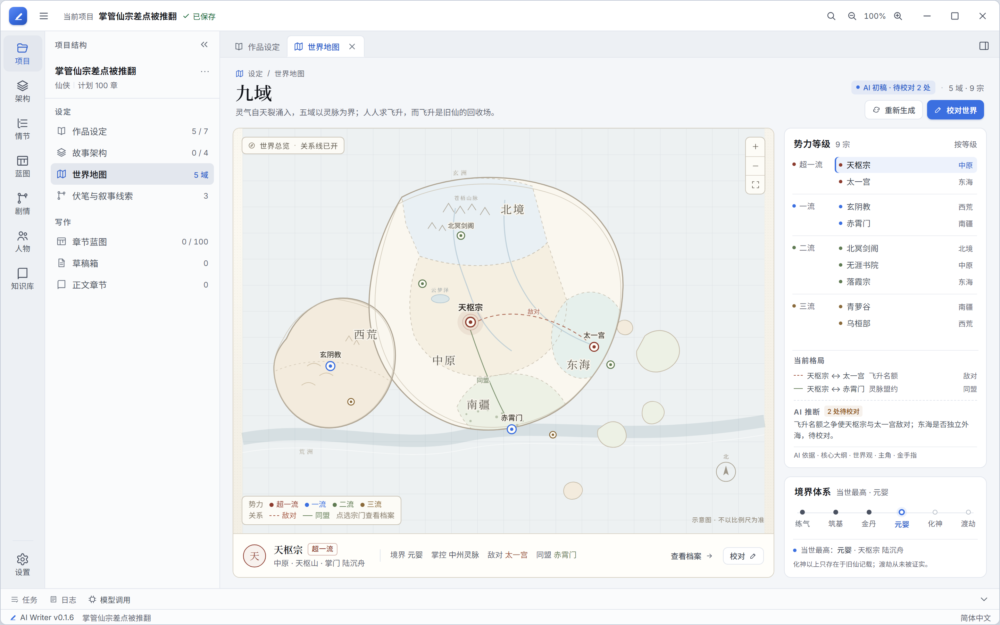
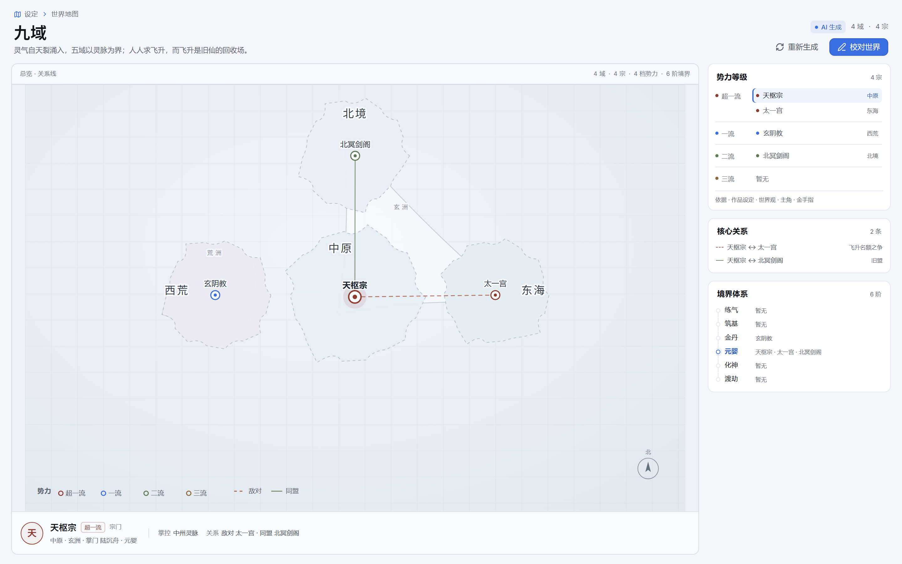
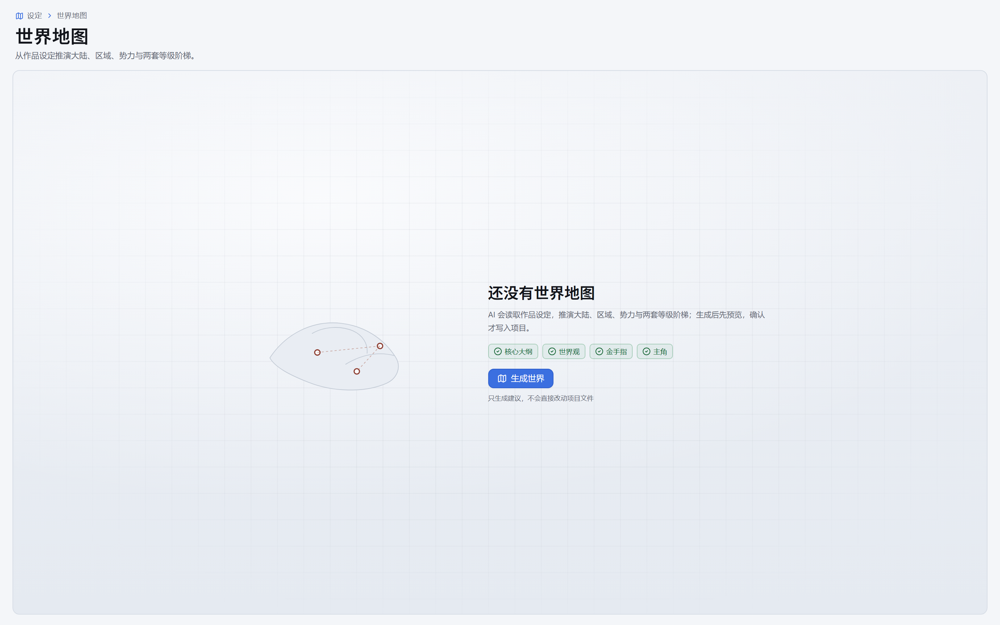
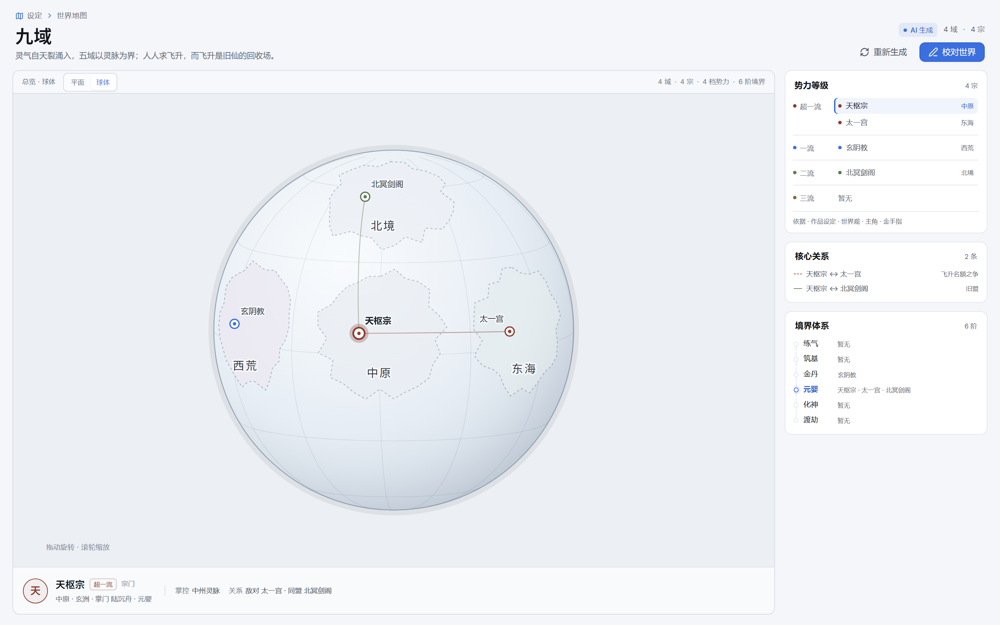

# 世界地图 — 世界一页

评审构图 A：全幅地图 + 双阶梯。目标不是做地图编辑器，而是让 AI 生成一份可读的世界结构，再由界面画成一张图，作者只做校对。

## 核心判断

每本书的大陆、区域和宗门数量都不同，所以不能给固定模板，也不能让作者从空白画布开始画。

- **AI 生成结构，不生成图片。** AI 产出大陆、区域、势力、等级和关系；图片不可编辑，也会让每个项目的视觉失控。
- **地图是视图。** 界面根据区域方位和相邻关系自动布局，生成稳定的示意图；作者拖拽只做微调。
- **人工只做校对。** 主入口是「生成世界」，不是填表；编辑是生成之后的纠正层。

## 页面结构

- **全幅地图**：左侧墨线示意图，区域用柔和色块，宗门用印标；默认只标一流以上宗门，其余保留小点。
- **势力等级**：右栏按超一流 / 一流 / 二流 / 三流分组列出宗门，选中项与地图联动。
- **境界体系**：另一条独立阶梯，练气 → 筑基 → 金丹 → 元婴 → 化神 → 渡劫；不与势力等级混用。
- **选中宗门条**：底部显示所在地、等级、掌门/境界、掌控资源、敌对与同盟，以及「校对」入口。
- **AI 来源**：页头显示「AI 初稿 · 待校对 N 处」；右栏列出 AI 推断与依据，提醒作者校对而不是盲信。

## AI 生成流程

1. **入口**：空态只有一个「生成世界」按钮，并列出会参考的设定（核心大纲、世界观、主角、金手指）。
2. **生成**：读取设定 → 推演大陆与区域 → 安排势力与等级 → 校验关系 → 绘制地图；步骤可见。
3. **预览**：先返回生成报告（例如 3 大陆 / 12 区域 / 9 宗门 / 2 套等级），确认后才写入。
4. **已生成**：地图页可缩放、点选、查看；「校对世界」进入编辑。
5. **重新生成**：展示差异摘要，可选择保留手改项或全部重来。

## 数据结构（最小集）

- `regions`：名称、上级大陆、方位（北/中/东/南/西）、相邻区域、地形、控制势力、一句话。
- `factions`：名称、类型、所在区域、势力等级、资源、关系（盟/敌/中立）、一句话。
- `tiers`：势力阶梯（可自定义档位）与境界阶梯（可自定义阶数）。
- `relations`：势力之间的敌对 / 同盟 / 中立及原因。
- `layout`：可选的作者拖拽偏移；AI 不输出像素坐标，布局由渲染器计算。

## 交互

- **总览**：只读、缩放、点选；关系线可开关。
- **校对**：点区域或宗门打开编辑卡；改等级、改名、换所在地，地图即时更新。
- **微调**：拖拽宗门或区域种子改变位置；「重新排布」恢复自动布局。
- **局部重生成**：后续支持只重写一个宗门或一块区域，避免改一处就重画全世界。
- **可选底图**：后续可上传作者手绘地图作为背景，但默认仍是自动示意图。

## 与现有页面的关系

- 入口在侧栏「设定」组：作品设定 → 故事架构 → 世界地图 → 伏笔与叙事线索。
- 消费作品设定里的世界观、核心大纲、主角和金手指；不复制这些文本。
- 视觉沿用冷灰图版、墨线、衬线标题和现有主题令牌，不另造一套 fantasy UI。

## 实现要点

- 新的结构化世界地图数据与持久化独立于 NovelConfig，存放在项目 `.vela/world-map.json`。
- AI 必须通过 `submit_world_map` 工具交付结构化参数；命令只做领域校验和归一化，不把可见 JSON 文本当契约，也不直接写盘。
- 地图用 SVG 渲染，布局只依赖区域拓扑；需要为 3–12 个区域、3–30 个势力准备密度策略。
- 生成/校对/重新生成三态都要有；不能只做一张静态图。

## 生产实现（第一版）

已落地的纵向切片：

- 侧栏「设定」组新增「世界地图」，打开独立 Tab。
- 页面具备空态、生成中、预览确认、已应用、读取失败五种状态。
- 生成通过 `submit_world_map` 一次性工具完成；模型参数先归一化为领域数据，校验失败会自动带错误清单重试一次。
- 预览不会写盘；点「应用地图」后写入项目 `.vela/world-map.json`。
- 已应用页支持点选势力、查看等级/境界/关系，以及「校对」面板修改势力名称、类型、所在地、等级、境界、资源、掌门与一句话定位。
- 地图由纯函数布局：方位 + 相邻关系推导区域位置，SVG 负责绘制；不依赖模型给像素坐标。
- 支持「平面 / 球体」切换：球体按区域方位映射到经纬度，使用正交投影和可见半球裁剪，支持拖动旋转与滚轮缩放，不引入 Three.js。
- 境界体系中「当世最高」按实际有势力占据的最高一阶标记，不默认最高阶。

关键文件：

- `src/shared/world-map.ts`：领域类型、工具参数归一化、持久化校验。
- `src/components/editor/WorldMapEditor.tsx`：页面状态与校对。
- `src/components/editor/world-map/`：布局算法与 SVG 地图。
- `src/services/workflows/commands/generate-world-map.command.ts`：生成命令与工具调用。
- `electron/pi/submit-tools.ts`：`submit_world_map` 工具 schema。
- `electron/controllers/world-map-controller.ts`：项目文件读写。

后续可扩展：区域级校对、局部重新生成、关系编辑器、手绘图底图。
